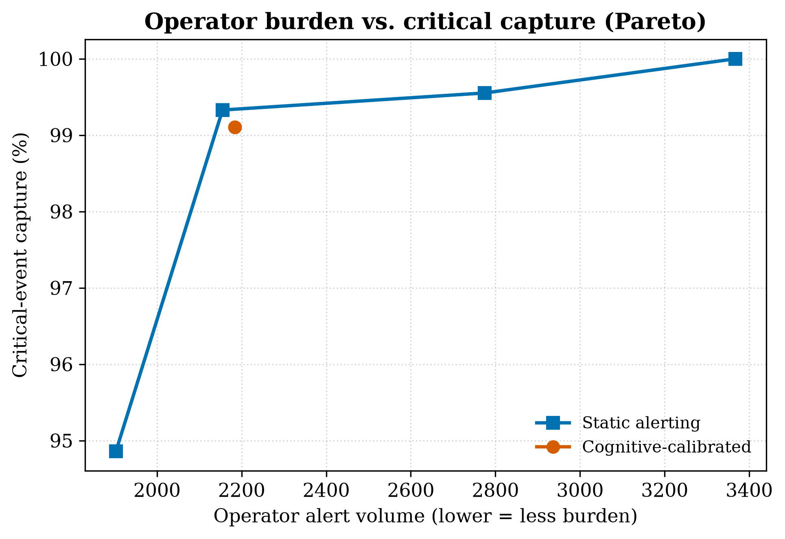
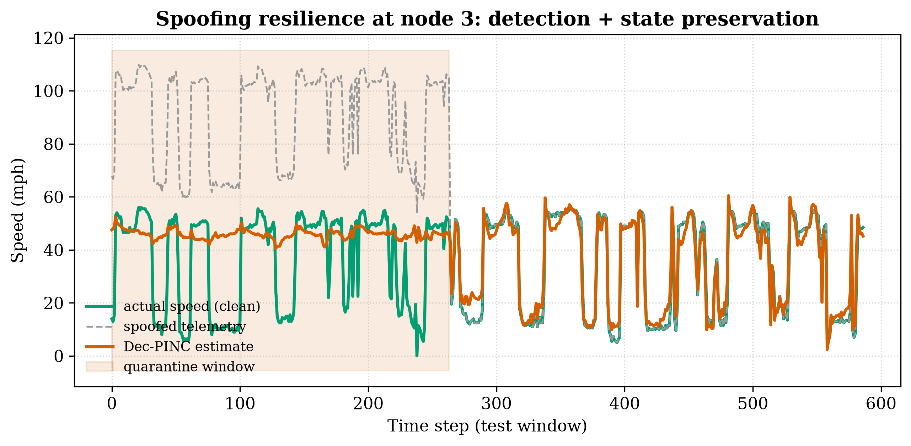
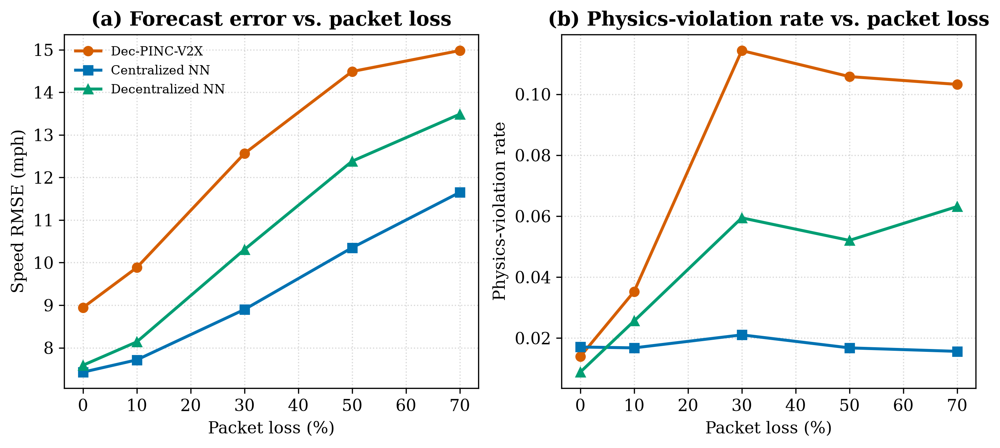

# Contested-Corridor Autonomy

**Physics-Guided Telemetry Verification and Cognitive-Calibrated Autonomy for Contested Mobility–Energy Corridors**

A reproducible, real-data research codebase for trustworthy decision support on coupled
traffic–energy corridors under contested communications (packet loss, latency, spoofing).
It contributes two validated components — a **physics-guided telemetry guard** and a
**cognitive-load-aware adaptive-autonomy layer** — and reports a transparent diagnostic
finding on decentralized physics-informed forecasting. Every number below is measured on
real public data and reproducible from this repo.

## Primary contributions (validated)

**1. Physics-Guided Telemetry Guard** (`src/security/telemetry_guard.py`)
Verifies incoming V2X/SCADA telemetry with three complementary, training-calibrated
checks — stale/replay runs, robust distribution shift, and an **inter-node flow-conservation
cross-check** — and emits an integrity score, anomaly flag and quarantine mask. On the
spoofing stress regime (real M25 corridor, test split):

| | |
|---|---|
| Anomaly **AUROC** | **0.954** |
| Detection delay | **0 steps** (immediate) |
| F1 | 0.71 |

**2. Cognitive-Load-Aware Adaptive Autonomy** (`src/hmi/cognitive_autonomy.py`)
An operator cognitive-load model (EWMA alert rate + concurrent unresolved + decision
complexity) drives a policy that suppresses low-criticality alerts under load, handles
routine stabilization autonomously, and always escalates high-consequence events with a
short physics-grounded rationale. Versus static alerting:

| | |
|---|---|
| Operator **alert-volume reduction** | **35.1%** |
| **High-criticality recall** | **99.1%** |
| Missed critical escalations | 0.9% |




## Diagnostic finding: decentralized physics-informed forecasting (Dec-PINC)

The decentralized physics-informed controller/forecaster (`src/models/decentralized_pinc.py`)
is reported transparently as a **diagnostic result, not a win**:

* Its **quarantine fallback does improve spoofing resilience** over classical baselines —
  spoofing-regime speed RMSE **13.0** vs **20.1** (Persistence/LOCF) and **17.3** (Ridge),
  and it roughly halves their physics-violation rate.
* But **soft PDE penalties at a 30-minute aggregation window do not outperform a centralized
  neural network on bulk forecasting**: across packet-loss levels Dec-PINC has the highest
  RMSE of the three neural models, and the ablation shows the physics penalty and multi-stage
  schedule do not improve accuracy here.

This is an informative negative result: it directly motivates **high-frequency (sub-minute)
telemetry** and **hard physical projection layers** (constraint projection rather than soft
penalties) as the next step, rather than soft PDE regularization at coarse cadence.



| Method (clean) | RMSE ↓ | Method (spoofing) | RMSE ↓ |
|---|--:|---|--:|
| Centralized NN | **7.43** | Centralized NN | **11.00** |
| Ridge | 7.81 | Dec-PINC | 13.00 |
| Dec-PINC | 8.94 | Ridge | 17.33 |
| Persistence (LOCF) | 8.09 | Persistence (LOCF) | 20.10 |

Full numbers: `results/tables/table1_main_benchmark.*`, `table2_ablation.*`, `table3_security_hmi.*`.

## Real data (keyless, reproducible, provenance-logged)

All streams are public, region-coherent (Great Britain), and cached with provenance in
[`data/manifest.json`](data/manifest.json):

| Stream | Source | Detail |
|---|---|---|
| Traffic | UK National Highways **WebTRIS** | 6 consecutive M25 MIDAS loop detectors (chainage 4052–4083, one carriageway, ~1.9 mi), 15-min speed & flow, Jun–Jul 2024 |
| Grid | **NESO / National Grid ESO** | GB half-hourly national demand (ND, TSD) |
| Weather | **Open-Meteo** archive | hourly temperature / wind / precipitation per node |

Aligned to a 30-min cadence → **2928 steps × 6 nodes × 5 features**, with strict
chronological train/val/test (0.6/0.2/0.2, **zero look-ahead**) and scalers/thresholds fit
on the training split only. The six nodes are *consecutive* detectors so inter-node flow
conservation is physically meaningful (adjacent-node flow correlation 0.96–0.99) — the basis
for the guard's conservation cross-check.

## Quickstart

```bash
pip install -r requirements.txt
python experiments/run_all_experiments.py     # ingest (cached) + train + Tables 1-3 + Figures 1-3
pytest                                         # 17 tests
```

The whole pipeline runs on CPU with no API keys. Seeds are pinned across Python/NumPy/PyTorch;
`results/environment.json` records versions.

## What's in it

* `src/data/` — real ingestion + provenance (`ingest.py`), spatio-temporal alignment and
  leak-free splits (`align.py`), and an **evaluation-only** contested channel
  (`contested_channel.py`): Bernoulli + Gilbert-Elliott packet loss, bounded/heavy-tailed
  latency, replay/step/ramp/bias spoofing.
* `src/security/telemetry_guard.py` — the physics-guided guard (**primary**).
* `src/hmi/cognitive_autonomy.py` — cognitive-calibrated adaptive autonomy (**primary**).
* `src/models/` — `decentralized_pinc.py` (diagnostic), `physics.py` (LWR continuity, coupled
  load-balance, control-stability residuals), `baselines.py` (Persistence, Ridge, LightGBM,
  Centralized NN, Decentralized-no-physics).
* `src/eval/` + `experiments/run_all_experiments.py` — Tables 1–3, Figures 1–3.

## Honest limitations / future work

* One short corridor (6 nodes, 2 months, 30-min cadence). The guard and HMI results are
  strong here but should be confirmed on more corridors and longer spans.
* Spoofing attacks are injected by us (labeled ground truth); a stronger evaluation uses
  stealthy, detector-aware attacks.
* The diagnostic forecasting result motivates **sub-minute telemetry** and **hard physical
  projection** layers; soft PDE penalties at coarse cadence did not help and are not claimed to.

## Layout

```
configs/{data,model,experiment}.yaml   real-data + model + experiment configs
data/{raw,processed,manifest.json}      cached pulls + aligned tensor + provenance
src/security/telemetry_guard.py         physics-guided anomaly verification (primary)
src/hmi/cognitive_autonomy.py           cognitive-calibrated adaptive autonomy (primary)
src/data/ , src/models/ , src/eval/     ingestion/alignment/channel, models, metrics/tables/figures
experiments/run_all_experiments.py      end-to-end: Tables 1-3 + Figures 1-3
tests/                                   physics math, anti-leakage splits, contested masks
```

## License

MIT. WebTRIS, NESO and Open-Meteo are public data sources, credited above.
